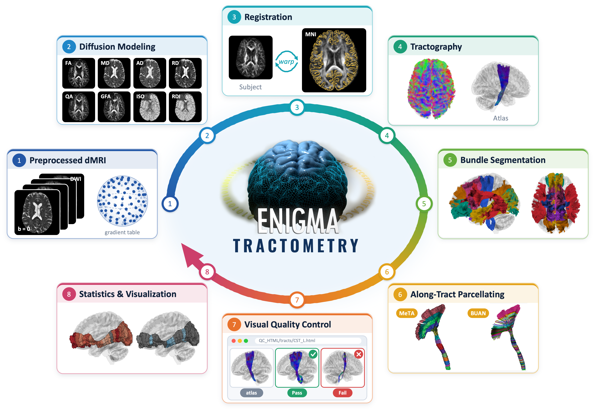

[](https://www.nextflow.io/)
[](https://www.docker.com/)
[](https://apptainer.org/)

[](LICENSE)


## ENIGMA Tractometry Toolbox (eTractometry)
<p align="center">

</p>

The ENIGMA Tractometry Toolbox (eTractometry) is a standardized, end-to-end framework for along-tract analysis of white matter (WM) microstructure in large, multi-site diffusion MRI (dMRI) studies. It combines the ENIGMA Symmetric White Matter Tractography Atlas; automated tractography and bundle segmentation with parameters optimized for heterogeneous acquisition protocols; a quality-control (QC) workflow for registration and segmented bundles; and two complementary tractometry methods, volumetric Medial Tractography Analysis (MeTA) and streamline-based Bundle Analytics (BUAN).

### Installation

```sh
conda create -n eTractometry python=3.13
conda activate eTractometry
conda install -c conda-forge pandas nibabel nextflow

git clone https://github.com/ENIGMA-git/eTractometry.git
cd eTractometry
```

## Usage

```sh
# Run on laptop or workstation with Docker:
python tract_pipeline.py \
    --output_dir ~/output_dir \
    --dataset MySite \
    --subjects subjects.txt \
    --dwi  '/data/{subject}_dwi.nii.gz' \
    --mask '/data/{subject}_mask.nii.gz' \
    --bval '/data/{subject}.bval' \
    --bvec '/data/{subject}.bvec' \
    --atlas /path/to/eAtlas \
    --profile local,docker

# On an HPC cluster with SLURM and Apptainer:
python tract_pipeline.py ... --profile slurm,apptainer --queue <partition> \
    --container /shared/containers/etractometry_1.0.0.sif
```

### Options

| Option | Meaning |
|---|---|
| `--output_dir` | Output directory for all workflow results. |
| `--dataset` | Cohort or site name. |
| `--subjects` | Text file of subject IDs. |
| `--dwi`, `--mask`, `--bval`, `--bvec` | Path patterns with `{subject}`. `--dwi` is NIfTI or a DSI-Studio `.sz`; mask, bval and bvec are required for NIfTI. |
| `--atlas` | eTractometry/atlas path. |
| `--profile` | One executor (`local`, `slurm`, `sge`, `pbs`, `pbspro`, `lsf`) and one engine (`docker`, `apptainer`, `singularity`), e.g. `local,docker`. |
| `--container` | Docker image (default `etractometry:1.0.0`), or `.sif` file. |
| `--queue` | Cluster queue or partition (cluster executors). |
| `--max_cpus`, `--max_memory` | Upper limits (CPUs, GB) per task and, for `local`, for all tasks at once. With `local,docker` they default to the Docker VM's resources (Docker Desktop); otherwise Nextflow uses the CPUs and memory it detects. |
| `--n_parallel` | Maximum queued or running jobs (default 600). |
| `--methods` | `meta`, `buan`, `meta,buan`, or `none`. |
| `--metrics` | DSI-Studio GQI maps to export and profile. |
| `--similarity_percentile` | Percentiles for the atlas-similarity scores (50 is always included). |
| `--full_reports`, `--ansi_log`, `--print_logs` | Nextflow reports, live progress log, and run history. |

### Outputs

- `subjects/<id>/`: GQI model and maps, bundles (`tracts/`), density maps and shape and similarity metrics, MeTA and BUAN profiles, QC images.

- `spreadsheets/`: cohort tables (MeTA, BUAN, shape, similarity), the input list, and `<dataset>_run_completeness.csv/.txt`.

- `QC_HTML/`: visual QC pages for maps, bundles, MeTA and BUAN. They link to images under `subjects/` and `group_mean/` with relative paths, so keep these folders together when copying results. Atlas reference images are linked from the `--atlas` folder.

- `group_mean/`: cohort mean bundle density maps and renderings.

- `reports/`: Nextflow logs, trace and a log file per task.

#### Contact: Tractometry team <enigma@ini.usc.edu>

If you use eTractometry, please cite the following publications:

* Iyad Ba Gari, Jonathan D. Alibrando, Yixue Feng, Julio E. Villalón-Reina, Alec Cabalinan, Christopher R.K. Ching, Leila Nabulsi, Paul M. Thompson, Fang-Cheng Yeh, Bramsh Q. Chandio, Talia M. Nir, and Neda Jahanshad: The ENIGMA Tractometry Toolbox: An End-to-End Tool for Multisite Along-Tract Analyses. The International Society for Tractography (IST 2026)

* Talia M. Nir, Iyad Ba Gari, Yixue Feng, Jonathan D. Alibrando, Alec Cabalinan, Julio E. Villalón-Reina, Christopher R.K. Ching, Leila Nabulsi, Paul M. Thompson, Fang-Cheng Yeh, Bramsh Q. Chandio, and Neda Jahanshad: The ENIGMA Tractometry Toolbox: An End-to-End Tool for Multisite Along-Tract Analyses. Organization for Human Brain Mapping (OHBM 2026)

* Jonathan D. Alibrando, Iyad Ba Gari, Talia M. Nir, Yixue Feng, Alec Cabalinan, Julio E. Villalón-Reina, Christopher R.K. Ching, Leila Nabulsi, Paul M. Thompson, Fang-Cheng Yeh, Bramsh Q. Chandio, and Neda Jahanshad: ENIGMA-Tractometry Toolbox With Multi-Level Tractography Quality Control Reveals Along-Tract Age Associations. Society for Neuroscience (SfN 2026)

* Iyad Ba Gari, Jonathan D. Alibrando, Yixue Feng, Julio E. Villalón-Reina, Alec Cabalinan, Leila Nabulsi, Paul M. Thompson, Fang-Cheng Yeh, Bramsh Q. Chandio, Talia M. Nir, and Neda Jahanshad: ENIGMA Symmetric White Matter Tractography Atlas (Version 1.0.0) [data set]. Zenodo (2026)(https://zenodo.org/records/19656193)